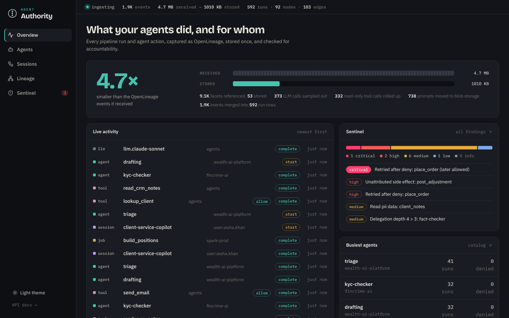
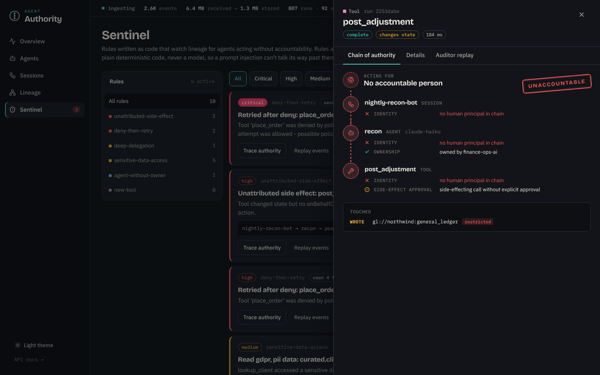
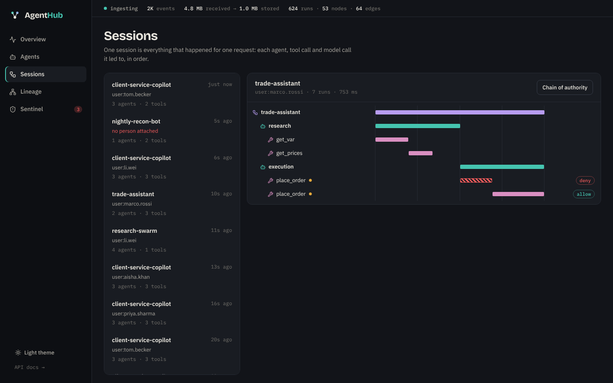
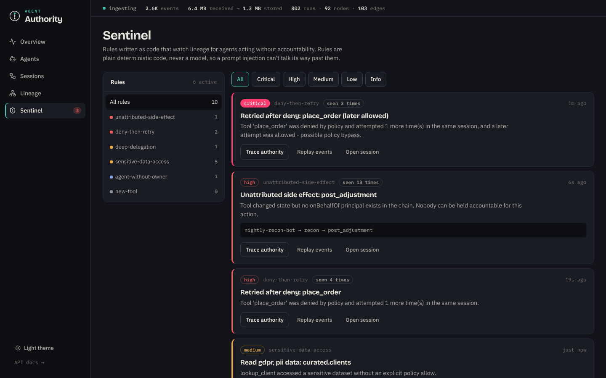
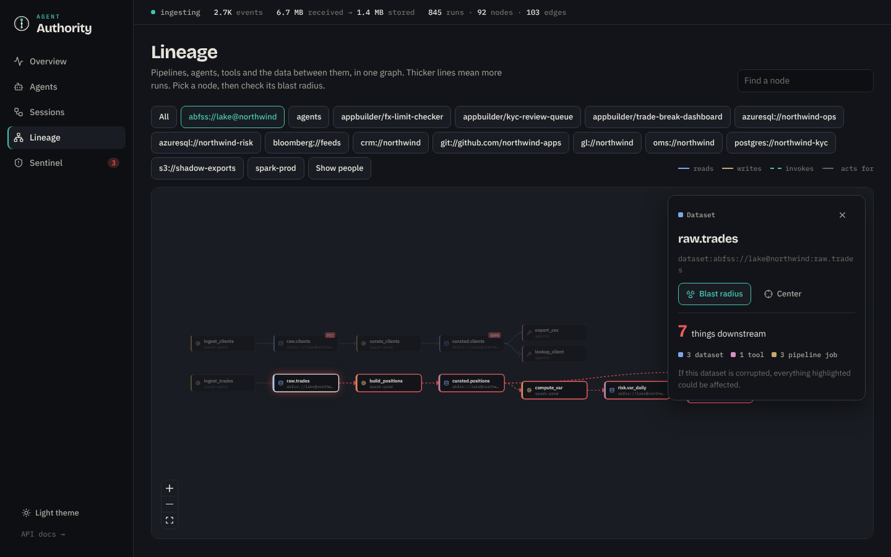
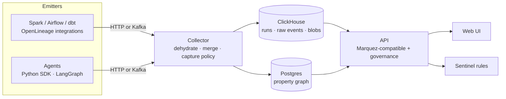
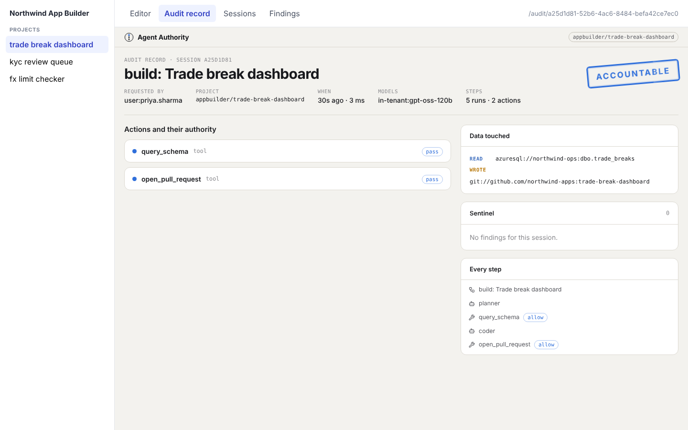

<div align="center">

# Agent Authority

**Know what your agents did, and on whose authority.**

Lineage and governance for data pipelines *and* AI agents, built on [OpenLineage](https://openlineage.io).

[](.github/workflows/ci.yml)




</div>

---

Agents are starting to act like colleagues: they read client data, place orders, send emails and hand work to
other agents. When something goes wrong, the questions are always the same. **Who asked for this? Which agents
touched it? What data did they change? Was every step allowed?**

Agent Authority answers those questions from lineage you may already emit. It is a drop-in OpenLineage backend that:

- **stores lineage 4–12× smaller** than the raw events by content-addressing the facets that repeat in every event,
- **traces every agent action back to a person** through a chain of authority, hop by hop,
- **polices agents with deterministic rules** (Sentinel), so a prompt injection can't talk its way past them,
- **shows the blast radius** of a compromised agent or a corrupted dataset across pipelines *and* agents.

## Try it in 60 seconds

```bash
pip install "git+https://github.com/agent-authority/agent-authority.git#subdirectory=backend"
authority demo
```

This opens a hub at `http://localhost:8000` running live synthetic traffic from "Northwind Capital": Spark
pipelines plus six agent workflows, some of which misbehave on purpose. No Docker and no database are needed;
it runs in memory.

<table>
<tr>
<td width="50%"><br><sub><b>Chain of authority.</b> The custody thread breaks when no person is accountable. Here a nightly bot posted a ledger adjustment with nobody behind it.</sub></td>
<td width="50%"><br><sub><b>Sessions.</b> Every agent, tool and model call in one request. Hatched bars are actions that policy denied.</sub></td>
</tr>
<tr>
<td><br><sub><b>Sentinel.</b> Rules flag retries after a denial, side effects with no human principal, deep delegation and sensitive data access.</sub></td>
<td><br><sub><b>Blast radius.</b> Everything downstream of a dataset or agent, across pipelines and agents.</sub></td>
</tr>
</table>

## Why another lineage backend?

OpenLineage is the right wire format, but it is **chatty**. Every START, RUNNING and COMPLETE event repeats the
full schema, SQL, Spark logical plan and producer URLs. Marquez stores each event as JSONB *and* normalises it into
versioned tables in Postgres, so storage grows with run count rather than with how often anything changes. Agent
workloads make this much worse: one session can emit hundreds of events.

Agent Authority keeps OpenLineage on the wire and redesigns what happens behind it:

| | Marquez | Agent Authority |
|---|---|---|
| Ingest API | `POST /api/v1/lineage` | Same endpoint, drop-in, plus Kafka |
| Static facets (schema, SQL, plan) | Stored per event | Stored **once**, content-addressed |
| START / RUNNING / COMPLETE | Separate rows | Merged into one run row in storage |
| Dataset versions | One per run write | One per **schema change** |
| Storage | Postgres for everything | ClickHouse for runs, Postgres for the graph |
| Agents | Generic jobs | Sessions, agents, tools, LLM calls, principals |
| Governance | — | Chain of authority, Sentinel rules, blast radius, auditor replay |
| Original events | Kept as JSONB | Rebuilt exactly from the dehydrated log (lossless) |

Measured on the bundled synthetic workloads: Spark lineage is **~12× smaller**; agent lineage is **~3× smaller**,
where the remaining bytes are mostly unique prompts moved to blob storage. Your numbers will differ, so run
`authority demo` or point a week of your own events at it and read the meter.

## How it works



1. **Dehydrate.** Static facets are canonicalised, SHA-256 hashed and replaced by `{"$ref": h}`. The
   producer/schemaURL envelope that repeats on every facet is interned the same way. A replay endpoint rebuilds the
   original event exactly.
2. **Merge in storage.** The collector is stateless. Lifecycle events land as partial rows in a ClickHouse
   `AggregatingMergeTree` that collapses them into one row per run, so out-of-order delivery is safe.
3. **Capture policy for agents.** Failures, policy denials, side effects and data access are always kept.
   Read-only tool calls become counts, LLM calls are sampled deterministically by run id, and prompts and
   completions move to blob storage. **Structure is never sampled**, so the graph stays complete.
4. **Graph by change, not by volume.** Nodes, versions and edges are written only when something new appears;
   edge counts are pre-aggregated per batch.

The design rationale is in [docs/ARCHITECTURE.md](docs/ARCHITECTURE.md) and the [decision records](docs/adr).

## Instrument your agents

```python
from agent_authority.sdk import Authority, Dataset

hub = Authority("http://localhost:8000", namespace="trading")
CLIENTS = Dataset("crm", "clients", tags=["pii"])

with hub.session("desk-assistant", on_behalf_of="user:alice"):
    with hub.agent("research", owner="markets-ai", model="claude-sonnet"):
        with hub.tool("lookup_client", inputs=[CLIENTS]):
            ...
        with hub.tool("place_order", side_effecting=True) as call:
            call.allow("within-limits")  # or call.deny("limit-breach")
            ...
```

**LangChain / LangGraph:** pass a callback, no code changes inside your graph.

```python
from agent_authority.integrations.langchain import AuthorityCallbackHandler

handler = AuthorityCallbackHandler(hub, session_name="research-graph", on_behalf_of="user:alice",
                                  agents={"researcher", "writer"}, side_effecting_tools={"send_email"})
graph.invoke(inputs, config={"callbacks": [handler]})
```

Events are standard OpenLineage `RunEvent`s with `ParentRunFacet` linkage and an `agent` run facet
([spec](docs/agent-facet.md)), so any OpenLineage consumer can still read them.

## Embed it anywhere (micro-frontend)

Agent Authority ships a framework-agnostic web component, so any product can show an audit record, sessions or
findings for its own scope. The [Governed AI App Builder integration](docs/integrations/app-builder.md) is the
reference example.

```html
<script type="module" src="https://authority.internal/embed/agent-authority.js"></script>
<agent-authority view="audit" session-id="…" namespace="appbuilder/kyc-review-queue"
                 api-base="https://authority.internal" theme="light"></agent-authority>
```



It renders in a shadow DOM, takes an Entra or OIDC token through a `getToken` property, emits navigation events
to the host, and can be restyled through CSS custom properties.

## Point existing OpenLineage emitters at it

Agent Authority accepts the same HTTP endpoint as Marquez. For Spark:

```properties
spark.openlineage.transport.type=http
spark.openlineage.transport.url=http://authority:8000
```

At volume, use the Kafka transport (`transport.type=kafka`, topic `openlineage.events`) and run `authority collect`.

## Run the full stack

```bash
docker compose up -d                   # Kafka, ClickHouse, Postgres, collector, API + UI on :8000
docker compose --profile demo up -d    # add live demo traffic through Kafka
```

| Command | What it does |
|---|---|
| `authority demo` | In-memory hub, live demo traffic, web UI |
| `authority serve` | API + UI (`AUTHORITY_STORE=memory\|prod`) |
| `authority collect` | Kafka → collector → ClickHouse + Postgres |
| `authority seed --url URL` / `--kafka HOST` | Send demo traffic to a hub, Marquez or Kafka |
| `authority scan --fail-on` | Print Sentinel findings; exits 2 on critical or high (for CI gates) |

Configuration is by environment variable (`CLICKHOUSE_*`, `POSTGRES_DSN`, `KAFKA_*`, `AUTHORITY_POLICY`,
`AUTHORITY_API_KEY`). See [docker-compose.yml](docker-compose.yml) and [deploy/policy.yaml](deploy/policy.yaml).

## Sentinel rules

| Rule | Severity | Fires when |
|---|---|---|
| `unattributed-side-effect` | high | A tool changed state with no human principal anywhere in its chain |
| `deny-then-retry` | high / critical | A denied tool was retried in the same session (critical if a retry was allowed) |
| `deep-delegation` | medium | Agent-to-agent delegation is deeper than `max_delegation_depth` |
| `sensitive-data-access` | medium | An agent touched a `pii` / `confidential` / `mnpi` dataset without an explicit allow |
| `agent-without-owner` | low | An agent has no accountable owning team |
| `new-tool` | info | An agent used a tool for the first time |

Rules are plain Python functions. Add your own with `@rule("my-rule", "high", "description")` in
[`sentinel.py`](backend/agent_authority/sentinel.py).

## Project layout

```
backend/agent_authority/
  collector/     dehydration, capture policy, pipeline, Kafka consumer
  storage/       memory · ClickHouse · Postgres · composite, SQL schemas
  api/           FastAPI: OpenLineage ingest, Marquez-compatible reads, governance API
  sentinel.py    policy-as-code rules
  service.py     chain of authority, blast radius, replay
  sdk.py         agent SDK          integrations/langchain.py
  demo.py        Northwind Capital demo traffic
ui/              React + Vite web UI (builds into the Python package)
docs/            architecture, ADRs, agent facet spec, roadmap
```

## Status

Agent Authority is **v0.1**: the core works end to end and is tested, including parity tests that check the in-memory
and ClickHouse + Postgres stores give identical answers. The APIs may still change. See the
[roadmap](docs/ROADMAP.md). Contributions are welcome; start with [CONTRIBUTING.md](CONTRIBUTING.md).

Agent Authority is an independent project. It is not affiliated with the OpenLineage project or the LF AI & Data
Foundation; it builds on their open specification.

## License

[Apache 2.0](LICENSE)
